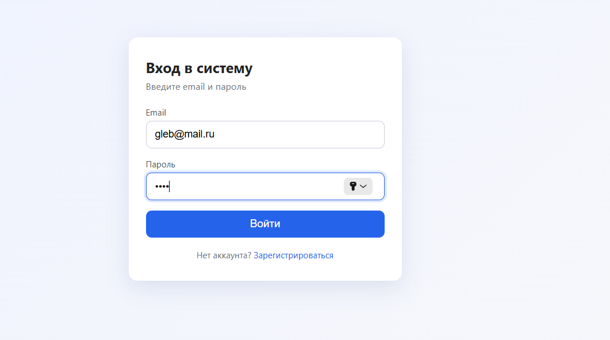
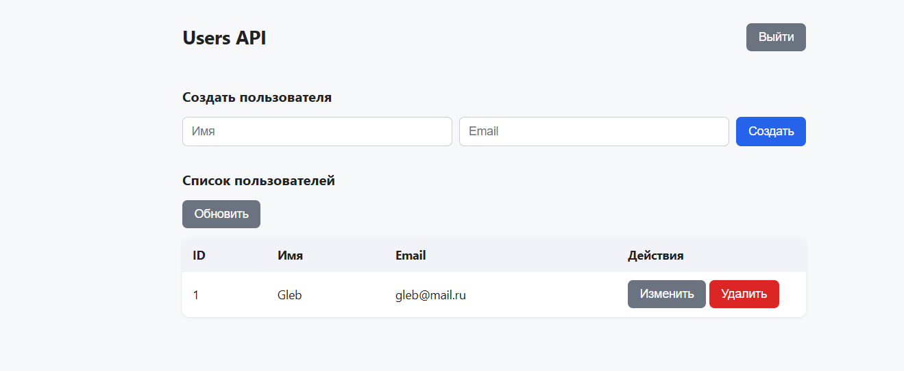
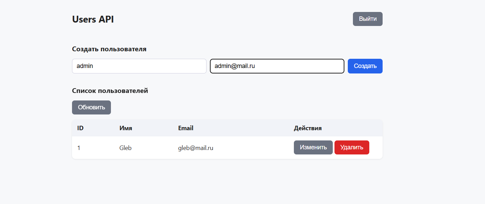
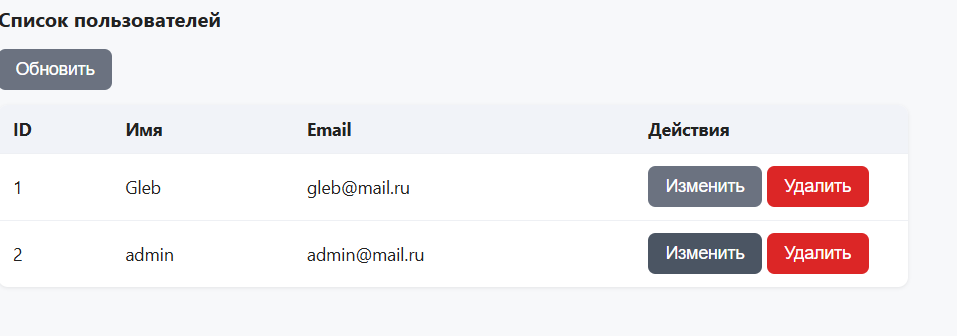
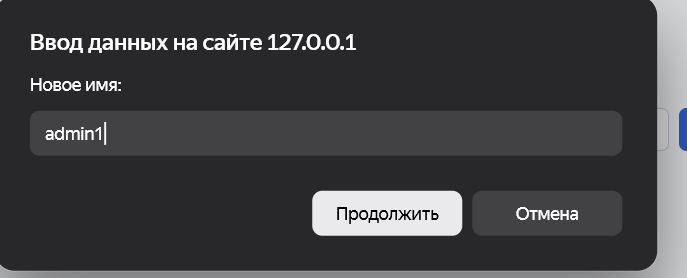
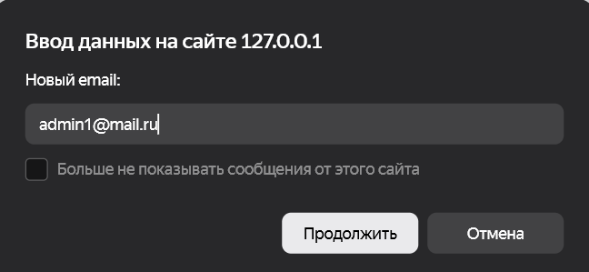
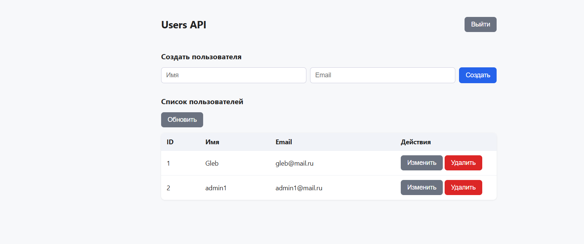
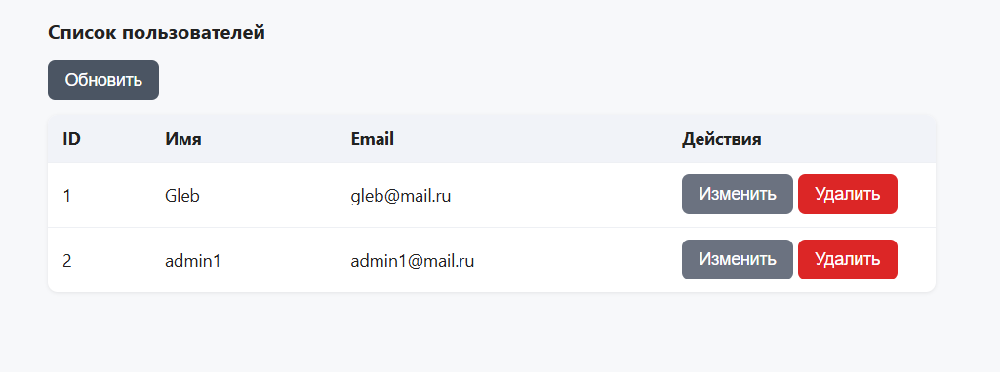
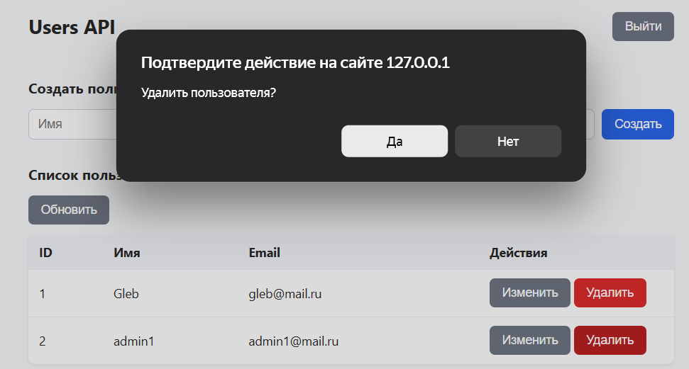
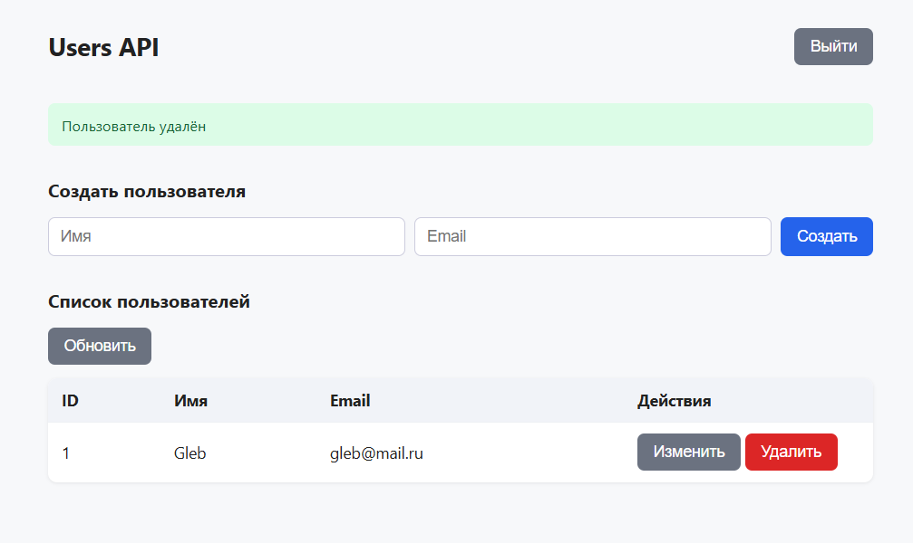

# Задание 7. Авторизация

В задании была указана библиотека `pyjwt`, но я использовал уже готовую библиотеку `fastapi-jwt`. Это расширение, которое использует PyJWT «под капотом», но предоставляет готовый интерфейс специально для FastAPI.

### Главная страница

### Регистрация пользователя

### Аутентификация

### Просмотр пользователей

### Создание пользователя

### Новый пользователь в списке

---

### Изменение пользователя
| Шаг 1 | Шаг 2 | Шаг 3 |
| :---: | :---: | :---: |
|  |  |  |

---

### Удаление пользователя
| Шаг 1 | Шаг 2 |
| :---: | :---: |
|  |  |